# Pocket First-Aid Librarian

An offline, hand-crank e-ink wilderness first-aid reference that fits in a pocket.
It runs on a Seeed **XIAO ESP32-S3 Plus** (16 MB flash, 8 MB PSRAM) with a PDM microphone and a
2.13" e-ink screen, works with no signal, and **never writes its own advice**: every card it shows
is a verbatim passage from a first-aid manual, with its citation on screen.

You can drive it with six buttons, or hold TALK and say what happened ("my buddy fell off a rock
and his ankle's swelling"). The voice side is a stack of small, purpose-built models and rules,
all designed and trained from scratch for this one job. **No generative language model runs on
the device.** Voice only ever picks which cited card to open.

> **Not medical advice.** This is a personal prototype, not a certified medical device, and most
> content trees are still unreviewed. In an emergency, call 911 or send an SOS first. Get real
> first-aid training; don't rely on a gadget.

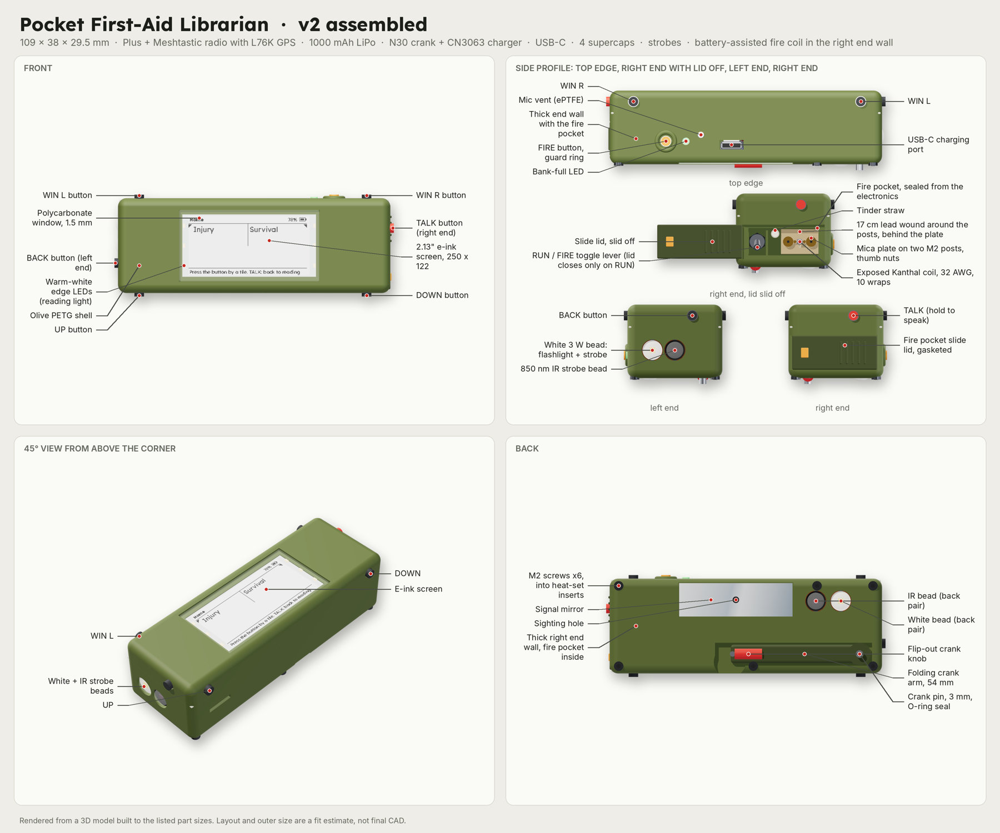

*v2 render from a 3D model built to the part sizes (fit estimate, not final CAD). More in [Hardware](#hardware).*

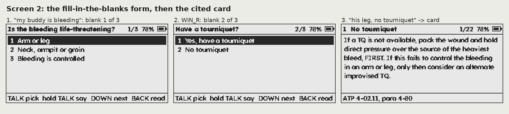

*The firmware's own screen code and C form engine running on the PC, public ATP 4-02.11 library,
typed input in place of speech (2026-11-23). How these are made: [`docs/screens/`](docs/screens/).*

## Contents

- [Scope](#scope)
- [Design rules](#design-rules)
- [How a spoken sentence becomes a cited card](#how-a-spoken-sentence-becomes-a-cited-card)
  1. [The keyword-spotting voice model](#1-the-keyword-spotting-voice-model)
  2. [The router: a small mixture of experts](#2-the-router-a-small-mixture-of-experts)
  3. [Slot filling: the fill-in-the-blanks intake](#3-slot-filling-the-fill-in-the-blanks-intake)
  4. [How filled slots point to cards](#4-how-filled-slots-point-to-cards)
- [The desktop pipeline: manuals to trees to cartridge](#the-desktop-pipeline-manuals-to-trees-to-cartridge)
- [Buttons-only mode](#buttons-only-mode)
- [Status and metrics](#status-and-metrics)
- [Hardware](#hardware) · [Repository layout](#repository-layout) · [License](#license)

## Scope

**In scope (v1):**

- Civilian **wilderness first aid** with no cell signal: bleeding and wounds, CPR and choking,
  fractures, sprains and dislocations, head and spine, burns, bites and stings, hypothermia and
  frostbite, heat and dehydration, allergy, asthma, diabetic emergencies, seizures, chest pain,
  altitude, drowning, lightning, eye injuries, and improvising gear when you don't have the kit.
- Content from two primary manuals, **Aerie Backcountry Medicine *Wilderness Medicine* (15th ed.)**
  and the **American Red Cross *Wilderness and Remote First Aid*** (2010), plus older US Government
  works (ATP 4-02.11, FEMA CERT, NWS, Ready.gov and others) for the public library.
- Buttons-only use, and voice on top of it.
- Rescue extras on the hardware: flashlight and IR SOS strobe, CPR pace light, LoRa SOS.

**Out of scope:**

- Any generative model on the device, or any device-written advice. Desktop-only helpers
  (Claude, local Ollama models) may help write *training sentences* and *test sets*; they never
  write card text.
- Open-ended speech transcription or chat. The recognizer only needs the words that fill blanks.
- Diagnosis. The device opens the manual's own card for the situation described; it doesn't
  decide anything the manual doesn't say.
- Military/tactical medicine as a focus, and survival topics for now (survival comes later).
- Sale or distribution. This is a personal prototype. The two primary manuals are copyrighted and
  used from personal copies only: **their text, citations, trees built from them, slot files and
  recordings of anyone's voice are never committed to this repository.** Only code, public-domain
  content, test fixtures, and metrics are.

## Design rules

1. **Tiny hardware on purpose.** Keep the intelligence narrow and make it fit an ESP32-S3, with
   clever on-chip tricks instead of co-processors.
2. **Buttons first.** Everything works perfectly with buttons alone. Voice is an extra layer.
3. **No generative AI on the device.** Fully offline. Every model output is an index: a word id,
   a topic id, a card id.
4. **Never invents text.** Only verbatim, cited passages. Life-threat cards are always reachable
   and never hidden.
5. **Built from scratch where possible.** The recognizer, router, slot filler, cartridge format
   and reader are all our own code.

## How a spoken sentence becomes a cited card

> **Status (2026-11-23):** every piece now exists in C and runs on the plain XIAO S3: the
> recognizer (0.49 s per second of audio, streaming), the router, and the form engine (identical to
> the Python on 766/766 test cases). They are joined in a beta firmware. What is still missing is a
> scored end-to-end test with real voices through the whole chain on the board
> ([details](#what-has-and-hasnt-been-tested-as-of-2026-11-23)).

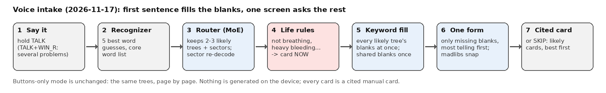

```
 hold TALK ──► 1. recognizer ──► 2. router (MoE gate) ──► life rules ──► 3. slot filling ──► form ──► cited card
 "fell, ankle,   keyword spotting   keeps top 2-3 trees      not breathing,    fills every likely    only the      or SKIP:
  swelling"      core list, then     loads their vocab +      heavy bleeding    tree's blanks at      missing       likely cards,
                 sector re-decode    templates                → card NOW        once                  blanks        best first
```

### 1. The keyword-spotting voice model

*Code: `pipeline/speech/fasr` (PR #17). Desktop training, on-device inference.*

The recognizer is a small acoustic model trained from scratch. It is a **keyword spotter**, not a
transcriber: its only job is to catch the words that fill blanks (body parts, animals, "spurting",
"can't walk", "not breathing", numbers, "skip"...). Word error rate on full sentences isn't the
target; keyword recall, wrong keywords per sentence and missed life-threat words are.

- **Model:** a causal 1-D convolutional network (depthwise + pointwise blocks, no recurrence, no
  attention) trained with **CTC** over 39 ARPAbet phonemes plus a word-boundary and a blank token.
  Three sizes are trained: s (0.52 M weights, 0.55 MB int8), m (1.03 M, 1.07 MB, the default on
  the bench board) and l (1.79 M, 1.85 MB, planned for the Plus's bigger flash). It streams,
  because every layer only looks backwards.
- **Lexicon-constrained decoding:** a beam search walks a phoneme trie built from a shared
  lexicon (`pipeline/plb/content/lexicon.yaml`, global uint16 ids, append-only, ids 0-9 reserved
  for unknown, numbers and commands). It can only spell words in the lexicon, so a new word needs a
  lexicon line, not retraining.
- **Garbage (filler) model:** off-list speech ("so we were hiking and...") is absorbed by a
  garbage word that outputs `<unk>` (id 0). Entering it and each phone inside it carry a penalty,
  which keeps real keywords from being swallowed while stopping chatter from turning into false
  keywords. A fitted reject score (8 signals) catches noise and non-speech.
- **Two-pass decode with genre vocabularies:**
  1. **Pass 1** decodes with a small *core* list: router words, life-threat words, numbers and
     commands.
  2. The router picks the likely **sectors** (genres such as bones and joints, bites and stings,
     cold, heat, breathing and CPR; see [`sectors.yaml`](pipeline/plb/content/voice/sectors.yaml)).
  3. **Pass 2** re-searches the *same* acoustic scores (no second pass through the network) with
     the union of those sectors' word lists. Smaller, relevant vocabularies mean fewer confusions.
     Life-threat words live in every sector so they are never dropped.
- **Biasing:** life-threat words get a decoder bonus, and a confident life word vetoes a reject.
  Form fields can bias toward the words their blank expects without forbidding anything else.
- **Output** is the router's `voice_hyp_t`: up to 5 best guesses, each up to 16 word ids with a
  0-100 confidence, plus a 0-100 reject score.
- **Training data:** LibriSpeech for general English sounds, then TTS voices speaking first-aid
  sentences, then recordings made through the device's own mic with a small recorder firmware.
  Wind, water, breath and echo noise are mixed in. Held-out sentences and a held-out speaker are
  never trained on. A Whisper + LoRA model on the desktop acts as a teacher to label unscripted
  clips; it never runs on the device.
- **On the device:** our own C engine (`firmware/components/asr`: front end, int8 layers with an
  S3 vector dot-product kernel, the same beam search) is bit-exact with the desktop export and runs
  the m model at 0.49 s per second of audio. It decodes while TALK is held, so the words are ready
  2-209 ms after TALK is let go.

### 2. The router: a small mixture of experts

*Code: `pipeline/voice_router/vr` (training), `firmware/components/vrouter` (C inference).*
*Design doc: [`docs/VOICE_ROUTER.md`](docs/VOICE_ROUTER.md).*

The router works like the **gating network of a mixture of experts (MoE)**. Each diagnostic tree
(fractures, bites, hypothermia...) is an *expert* with its own vocabulary and its own blank
template. The router reads the recognizer's word ids and scores every tree, then keeps the
**top 2-3** (top-k gating). Only those experts take part in the rest of the turn.

- **Model:** each word id maps to an embedding row, weighted by recognizer confidence and by which
  guess it came from. Hashed word pairs and "word after a negation" rows let "can't move" and
  "isn't broken" mean what they say. The rows are averaged into one small ReLU layer and a softmax
  over topics, plus a "reject / say that again" class. Training-only tricks (character trigrams
  folded into word rows, a MiniLM teacher for the starting rows, distillation) cost the device
  nothing.
- **Deployment:** int8 weights in a `VXP1` blob, read in place from memory-mapped flash. The
  router (about 88 KB) is always mapped. When it picks the top trees, their **sector vocabularies
  and slot templates** are the only ones brought into the working set for pass 2 and slot filling.
  That is the "MoE into RAM" idea: many experts on flash, only the 2-3 relevant ones active.
  Host test parity between the Python and C versions is within 1e-7.
- **Safety:** life-threat words are pinned so they always reach the life rules, the router only
  auto-opens a topic at 97% confidence or more (otherwise it offers tiles), and anything off-topic
  rejects instead of guessing.

### 3. Slot filling: the fill-in-the-blanks intake

*Code: `pipeline/voice_router/vr/intake.py`, `vr/form.py`. Plain-English overview:
[`docs/VOICE_INTAKE.md`](docs/VOICE_INTAKE.md).*

The technical name for this is **slot filling**, also called **frame-based** or **form-filling
dialogue**. Each tree is a *frame* (a template) with *slots* (blanks): body part, cause, animal,
bleeding type, can walk, still bleeding, getting worse, and so on. Blanks shared across trees
(awake, breathing, bleeding, where, how long ago, age) are filled once for every tree.

1. **The first sentence fills as many slots as it can**, in every candidate tree at once. Each slot
   lists the words and phrases that fill each value. A slot is only ever filled by a word the
   person actually said, **never guessed**. Negated or hedged words fill nothing ("not
   spurting", "can't tell if she's breathing"). When two values match, ties go to the most severe.
2. **Life threats first.** Every candidate tree has life rules (not breathing, unresponsive,
   spurting blood, bone through the skin...). If one fires, its card opens straight away on the
   first sentence with the general "do this now" text.
3. **Screen 2 is one form** that lists every blank still open on the way to a card, the **most
   telling** one first (the blank that splits the remaining cards most evenly). Follow-up blanks
   appear as answers land ("which bone" once "arm" is known). If the trees still compete, a
   "Which is it?" field sits on top. One spoken answer can fill several blanks at once.
4. **Each blank has its own short answer list** and a field decodes against that list. A near-miss
   word **snaps** to the closest answer by fuzzy string match ("ankel" to ankle, "thigg" to thigh),
   but only when one answer is clearly closest (score at least 0.80 and 0.10 ahead of the next).
   **Life-threat slots never snap**: there a near miss asks again instead.
5. **Ranked cards even with partial answers.** Every card the filled slots still allow is ranked,
   emergency cards first and then by partial evidence, so the right card is usually in the **top 3
   even with only about 60% of its blanks filled**.
6. **Skip** with UP+DOWN together, or say "skip" or "I don't know": the device lists those ranked
   cards to pick with the buttons.
7. **Tabs:** hold **TALK** for one problem. Hold **TALK + WIN_R** for a complex case or several
   injuries: each problem the sentence names opens in its own tab (up to 5 windows, WIN L/R to
   switch), each with its own form.

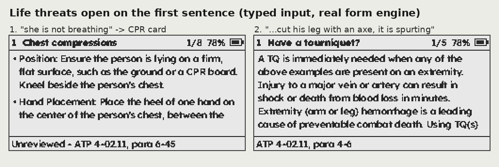

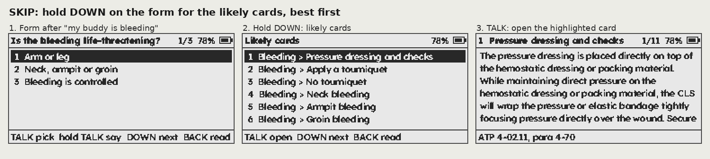

*Firmware screens run on the PC (2026-11-23): public ATP library, typed input in place of speech,
demo word lists from [`docs/screens/public_slots/`](docs/screens/public_slots/).*

**Tabs** are in the C form engine (sorted by urgency: bleeding, CPR, choking, anaphylaxis, other
life threats, head and spine, burns, shock, the rest), but the beta firmware shows only the first,
most urgent tab so far. The tab bar below is still the 2026-11-17 mockup, not a screenshot:


### Keyword search: say one word

A second voice mode for when you just want a topic. **Menu > Search by word**, hold TALK and say
one word ("tourniquet", "ankle", "burn"). Every card that word fits comes back as ranked tiles in a
4 x 2 grid, life-threat cards first only when the word really matches them (shown white on black).
UP/DOWN move, WIN_L/R page, TALK opens, BACK leaves. The index is built on the desktop
(`vr/search.py`) and the C ranks it on the device (`components/vform/vform_search.c`).

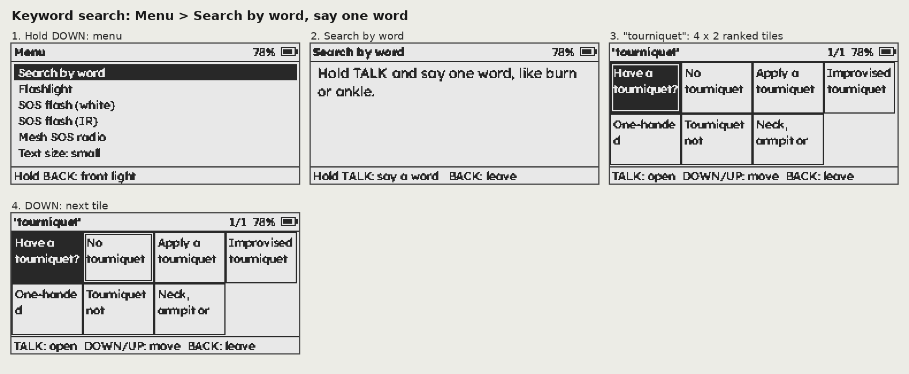

### 4. How filled slots point to cards

The trees stay the single source of truth. Slot filling never adds a path the tree doesn't have;
it only **walks the tree for you**.

- Each **question card** in a tree carries `slot:` (the blank it asks), and each of its answers
  carries `value:` (what that answer means). For example, a "Where is the bite?" card has
  `slot: where`, with answers `value: limb` and `value: face` leading to different cards.
- A per-tree **slot map** adds the words that fill each value, the **life rules** (`if:
  {breathing: "no"}` then go to the CPR card, checked in order, first match wins, optional
  `unless:`) and `implies:` links (forearm implies arm, so a fine answer satisfies a coarser card).
- `walk()` starts at the tree's root. At each question card it looks up the filled value for that
  card's slot and follows the matching answer. At a plain card it only moves on if exactly one way
  forward leads to an answered blank. It stops at the first card whose blank is still empty (that
  becomes a form field) or at a final answer card (which opens).
- So the blanks are just a faster way to press the same buttons: **voice and buttons always end on
  the same signed-off, cited card.**
- The desktop builder checks the wiring at bake time (`plb slots`): every answer value is unique
  on its card, every answer and life rule points at a card that exists, every life rule names a
  slot and value some card actually uses, and the router's slot files agree with the trees.

## The desktop pipeline: manuals to trees to cartridge

*Code: `pipeline/plb` (builder), `romkit/` (cartridge format and C reader), `pipeline/gpu/bake.sh`.*

```
 manual PDFs ──► extract ──► diagnostic trees ──► checks ──► pack ──► library.bin ──► flash
 (sha256-pinned)  numbered     question cards       verbatim,   Re-Pair +   read in place
                  paragraphs,  with slots, answer   slots,      Huffman     by the C reader
                  figures      cards with cites     schema      text
```

1. **Extract.** Each manual PDF is pinned by sha256. The builder pulls numbered paragraphs,
   headings and figures into an intermediate form.
2. **Build diagnostic trees.** Each topic becomes a YAML tree: question cards (with `slot:` and
   `value:` for voice) leading to answer cards. An answer card holds **only verbatim passages**
   with their page or paragraph citation. Where the manuals disagree, the choice goes to Charlie
   one item at a time. Every "use your kit" branch has an "I don't have this" path to the
   improvised-gear tree.
3. **Bake.** `bake.sh` runs every check and fails on real problems: schema validation, `plb
   verbatim --cards` (each card's words must appear on the cited PDF pages), `plb slots` (the
   wiring checks above), packing, a readback of every card through the C reader, and the voice
   intake simulation for each tree.
4. **Pack.** `romkit` packs a Game Boy-style cartridge, `library.bin`: dictionary-coded text
   (Re-Pair + canonical Huffman), 1-bit pictures (context model + range coder), the tree table,
   and the region/season tags. The firmware reads it in place from flash with no filesystem.
   Format spec: [`romkit/FORMAT.md`](romkit/FORMAT.md).
5. **Two libraries.** The *public* library uses only US Government works and lives in this repo.
   The *personal* library adds the Aerie and Red Cross trees, is built only on the desktop from
   personal copies, and is flashed to Charlie's own device. It is never committed.

## Buttons-only mode

Buttons are unchanged by the voice rebuild. The start screen has two tiles, **Injury** and
**Survival**, leading to folder tiles and topic tiles. Inside a topic the tree goes page by page:
one question per screen, one button per answer, then the cited card. Answer tiles also carry
numbers 1-4, so you can say the number. Context tags (activity, season, US state) hide pages that
don't apply; emergency pages are never hidden. Waking from sleep returns to the last page.

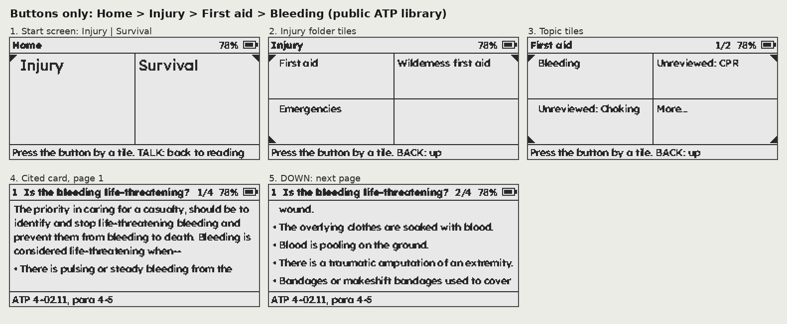

*Button mode from the PC screen simulator, public library, 2026-11-23. Every card shows its
citation on the bottom line.*

## Status and metrics

*Hardware: all bench work so far is on a plain XIAO ESP32-S3 because the Plus delivery is delayed
([details](#hardware)). Every number below says which setup and which date it measured.*

**Read this first:** each piece of the voice flow is now built and checked on its own, and the
pieces run together in a beta firmware on the bench board. The accuracy numbers still come from
desktop simulations (typed sentences, or recordings with the right tree given). A scored test of
real voices going through the whole chain on the board has not been run yet.

### Why the intake changed, and what the older results measured

The voice intake was redesigned twice (2026-11-16 and 11-17), so older numbers measure different
things and can't be compared directly.

1. **Router + page-per-prompt tree walk (up to 2026-11-16).** The router picked **one topic**, then
   the tree was walked one question per prompt. Tests from this stage measured only the router
   (right topic from one typed sentence), never reaching a card.
2. **Slot filling on top of the page walk (11-16 to 11-17).** The first sentence also filled
   blanks, so answered pages were skipped, but what was left was still asked one page per prompt.
   This is the "one question per page" column below.
3. **One fill-in-the-blanks form (11-17, current).** Every open blank shows on **one screen** and
   can be answered in one reply, and the router keeps the top 2-3 trees. "Turn 2" now means one
   reply to the form, however many blanks it holds.

### What has and hasn't been tested (as of 2026-11-23)

| Piece of the voice flow | Tested? | How |
|---|---|---|
| Recognizer (s, m, l sizes) | Yes, desktop | Charlie's 120 held-out clips + held-out synthetic voices in wind and water (2026-11-21/22) |
| Recognizer on the board | Yes, speed and parity | m model bit-exact with the desktop export on 633/633 clips; 0.49 s per s of audio; streaming (2026-11-21/22) |
| Router keeping top 2-3 trees for the form | Yes, desktop | `keep_trees` cut checked on 666 dev lines, 122 guard lines, 10 multi-injury scenes (2026-11-23) |
| Slot filling + one-form screen | Simulated | Typed sentences, right tree given (below), plus recognizer 5-best into the form (below) |
| Form engine in C on the board | Yes, parity | 766/766 cases identical to the Python on the S3, avg 585 ms per screen (2026-11-18); 773/773 on the run17 trees (2026-11-20) |
| Keyword search in C | Yes, parity | 54/54 words identical to the Python (2026-11-20) |
| Multi-injury tabs | Engine only | Python + C split and sort tabs (193 parity cases); firmware shows the first tab only |
| Form, SKIP, search screens in firmware | Yes, beta | Running on the bench board; screenshots above from the PC sim of the same code |
| Whole chain with real voices, scored | **No** | Next: Charlie's round-3 recordings through the beta firmware |

| Piece (not voice) | State |
|---|---|
| Cartridge format, C reader, public library | Working on the bench |
| Personal trees (Aerie + Red Cross), 24+ topics | Built and baked on the desktop (run17), verbatim, **unreviewed** |
| Buttons-only mode | Working on the bench |
| Fire coil | Simulated only (below) |

### Slot-filling simulation (form engine, typed text, 2026-11-17)

Setup: form sim at engine 7005be8, slot files v16b2, desktop. Input is **typed** test sentences
written by language models (dev by local models, test2 and test3 held out; not speech, not
Charlie's own words). The **right tree is given** (no router), and on turn 2 the simulated person
gives the right answer for every open blank. It is a best case for the slot engine and the trees.

| Set | Turn 1 | Turn 2, one question per page (stage 2) | Turn 2, one form (stage 3, current) | Turn 3, form |
|---|---|---|---|---|
| dev (666 lines) | 70% | 84% | 91% | 91% |
| test2, held out (612) | 44% | 65% | 81% | 82% |
| test3, held out (678) | 41% | 68% | 79% | 79% |

Life-threat guard: 0 of 119 calm sentences opened a life card. The goal in real use is 70-80% by
turn 2 and 100% by turn 3, with CPR and severe bleeding on the first sentence. Turn 1 is low partly
by design, because many test lines don't state the deciding facts.

The older chart for engine b4d9b2c is kept at
[`docs/voice/2026-11-17_turn-accuracy_run-b4d9b2c_test-1.png`](docs/voice/2026-11-17_turn-accuracy_run-b4d9b2c_test-1.png).

### Recognizer into the form (right tree given, 2026-11-17)

The recognizer's 5-best fed straight into the form, speech commit 58a52b7, model `firstaid` (s):

| Clips | Right card top-1 after turn 1 | After turn 2 |
|---|---|---|
| 600 TTS clips (decoded, not rejected) | 63% | 80% |
| 56 of Charlie's bench clips | 73% | 95% |

### Recognizer size: s vs m vs l (2026-11-21/22)

Same round-2 training data, same scoring code. Charlie's 120 held-out clips (his voice, device mic):

| | s (0.55 MB) | m (1.07 MB) | l (1.85 MB) |
|---|---|---|---|
| Key words caught | 69% | 78% | 78% |
| Wrong key words per clip | 0.30 | 0.31 | 0.29 |
| Right sentence in top 5 | 27% | 27% | 32% |
| Life words missed, all synthetic sets | | 276 | 155 |

Noise reject 99-100% for all sizes. m is the bench default; l is planned for the Plus once it is
timed on the board. Full table: `pipeline/speech/docs/RESULTS_sizes.md` (PR #17).

### Router (desktop, 2026-11-21)

32 trees, trained on 3.8k local-model sentences, tested on 678 held-out sentences + 157 scenarios.
Keyword picking alone: 46% top-1, 66-74% top-3. The small distilled router (127 KB): 71% / 89% and
66% / 84% on the two test sets. A 944 KB router did no better, and a MiniLM teacher reached 74% /
90%, so **data, not size, is the limit**. Wrong auto-opens: 0-1 of 678.

### On the board (plain XIAO S3, 240 MHz)

| What | Result | Date |
|---|---|---|
| Form engine, 766 real-tree cases | Identical to the Python; avg 585 ms per screen, max 1.24 s | 2026-11-18 |
| Recognizer m, per second of audio | 3.35 s before, **0.49 s** after the speed work (front end 0.05, model 0.26, search 0.18), bit-exact | 2026-11-21 |
| Recognizer streaming, 8 clips | Same words as whole-clip decoding; words ready 2-209 ms after TALK is let go | 2026-11-22 |

### Run captures

Every training run, simulation and test saves a terminal-style capture with metrics only, never
manual text or voice, named `<date>_<what>_run<N>_test<N>.png`:

- [`docs/runs/`](docs/runs/): form and router simulations.
- `firmware/docs/runs/`: C parity, on-board form bench, recognizer speed and streaming (firmware branch).
- `pipeline/speech/docs/runs/`: recognizer training, evaluation, int8 export, size comparison (PR #17).
- [`docs/hardware/coil-sim/`](docs/hardware/coil-sim/): fire-coil heating simulations.
- [`docs/screens/`](docs/screens/): the README screen pictures, rebuilt by a script.

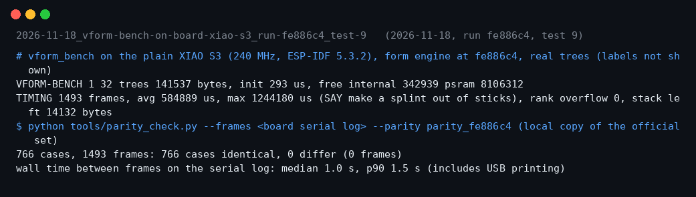

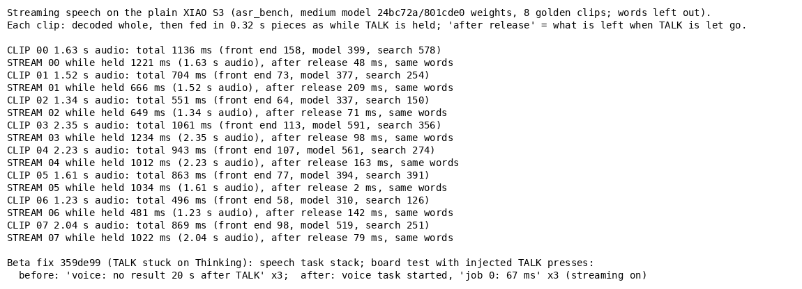

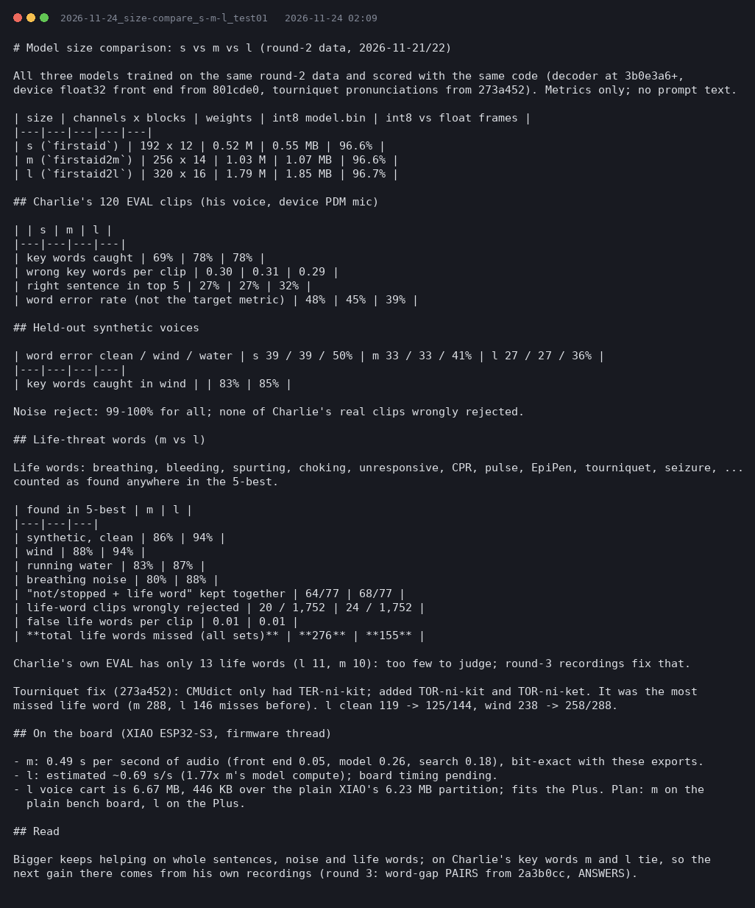

**Next:** Charlie's round-3 recordings scored through the beta firmware end to end, the tab bar on
screen, timing the l model on the board, and Charlie's review of the personal trees.

## Hardware

> **Why the bench uses a plain XIAO ESP32-S3:** the target board is the XIAO ESP32-S3 Plus, but
> its delivery has been held up. Until it arrives, everything is prototyped on a plain XIAO S3,
> which has the same chip and 8 MB PSRAM but less flash. Bench results and wiring notes refer to
> that stand-in board, and the Plus build and timings follow once it lands.

| Part | Choice (v2) |
|---|---|
| Brain | Seeed XIAO ESP32-S3 Plus (16 MB flash, 8 MB PSRAM); a plain XIAO S3 stands in on the bench |
| Screen | Waveshare 2.13" B/W e-ink, 250×122, edge-lit by warm-white LEDs |
| Mic | Adafruit PDM microphone, powered from a GPIO |
| Buttons | 6 sealed buttons (window left/right, up/down, TALK, BACK) plus a guarded FIRE button |
| Rescue signals | 3 W white bead (flashlight, Morse SOS), 3 W 850 nm IR bead (SOS for night vision), CPR pace LED, signal mirror |
| Mesh SOS | Second XIAO S3 + Wio-SX1262 LoRa (Meshtastic) with an L76K GPS, power-switched |
| Power | 1000 mAh LiPo; hand crank (N30 gear motor) and USB-C; 4 supercaps; cold cutoff stops charging below freezing |
| Fire starter | Battery-assisted Kanthal coil (32 AWG, 10 wraps, about 2.8 ohm) in a sealed pocket in the end wall |
| Case | About 109 × 38 × 29.5 mm (v2 fit estimate), PETG, gasketed |

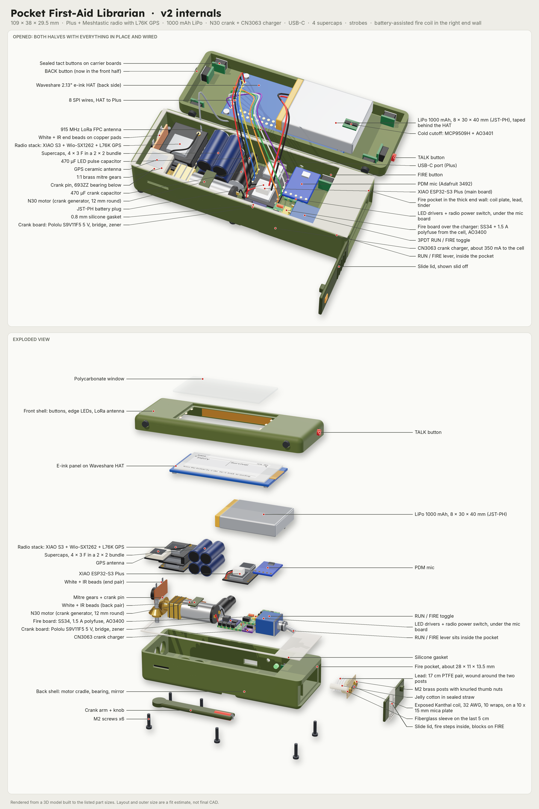

*v1 (about 102 × 38 × 21 mm, 300 mAh, no GPS or fire pocket) is kept for comparison:
[`2026-11-20_device-render-v1-assembled_run1_test1.png`](docs/hardware/renders/2026-11-20_device-render-v1-assembled_run1_test1.png).
Renders are from a 3D model built to the listed part sizes, not final CAD.*

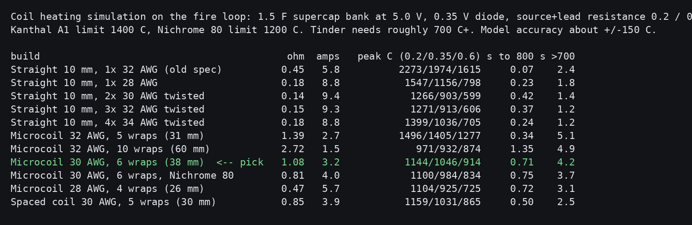

*Fire-coil simulation (desktop, 2026-11-20), run 1: peak temperature, time to 800 C and time above
700 C for straight wires and microcoils fed from the supercap bank. Run 2 tries a Pololu regulator
topping up the caps during FIRE; run 3 runs the coil from the LiPo with the caps in parallel, by
wrap count, cell charge, cold and wind (all in [`docs/hardware/coil-sim/`](docs/hardware/coil-sim/)).
The pick has since moved to the battery-assisted 32 AWG, 10-wrap coil above. Not yet built or
bench-tested.*

Pin map: `firmware/main/board.h`. Bench wiring and flashing: [`firmware/README.md`](firmware/README.md).

## Repository layout

| Folder | Contents |
| --- | --- |
| `firmware/` | ESP-IDF 5.3 C firmware (e-ink, buttons, lights, sleep, voice), `components/vrouter`, the recorder firmware, and the PC screen simulator |
| `romkit/` | Cartridge format: packer, text and picture codecs, font packer, C reader, tests |
| `pipeline/plb/` | The manuals-to-cartridge builder: extraction, trees, verbatim and slot checks |
| `pipeline/voice_router/` | Router, experts, slot filling and form engine, simulators |
| `pipeline/speech/` | The keyword-spotting recognizer: model, decoder, training, evaluation, export |
| `pipeline/gpu/` | Desktop scripts (bake, long training runs with pause/resume) |
| `docs/` | [`VOICE_INTAKE.md`](docs/VOICE_INTAKE.md), [`VOICE_ROUTER.md`](docs/VOICE_ROUTER.md), [`DESIGN_HISTORY.md`](docs/DESIGN_HISTORY.md), figures, run captures, `screens/` (README screen pictures + script), `hardware/` (renders, coil sims) |
| `hardware/` | Parts lists, wiring and enclosure files (coming) |

`firmware/components/cart` points at `../../../romkit/reader`, so keep `firmware/` and `romkit/`
side by side. CI runs the schema check, the pipeline tests and the reader tests on test fixtures
only, with no manual PDFs.

How every idea changed, the dead ends and the decisions are in
[`docs/DESIGN_HISTORY.md`](docs/DESIGN_HISTORY.md).

## License

- Code: [GPL-3.0](LICENSE).
- Fonts in `romkit/fonts/`: SIL Open Font License 1.1.
- Public library content: US Government works, public domain (17 USC 105), cited on every card.
- The Aerie and Red Cross manuals are copyrighted. Nothing from them is in this repository.
