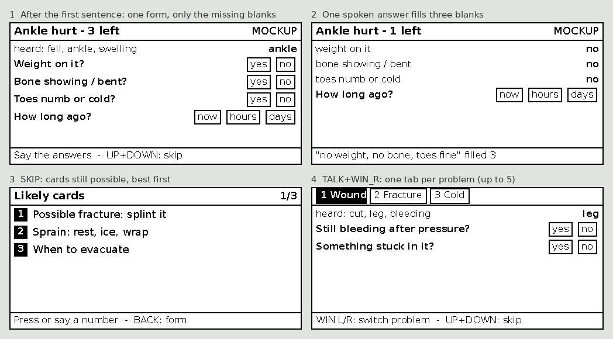
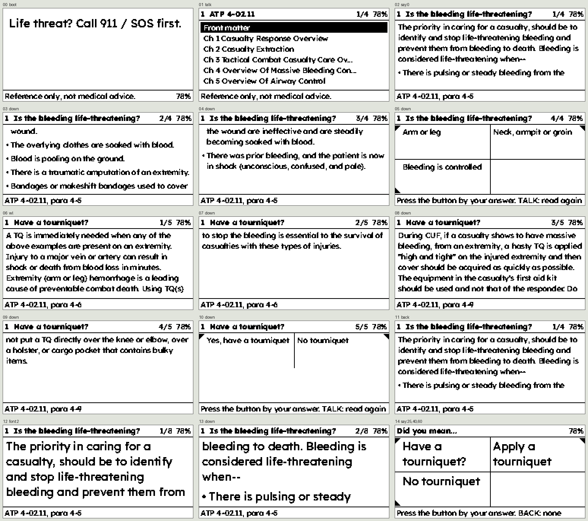
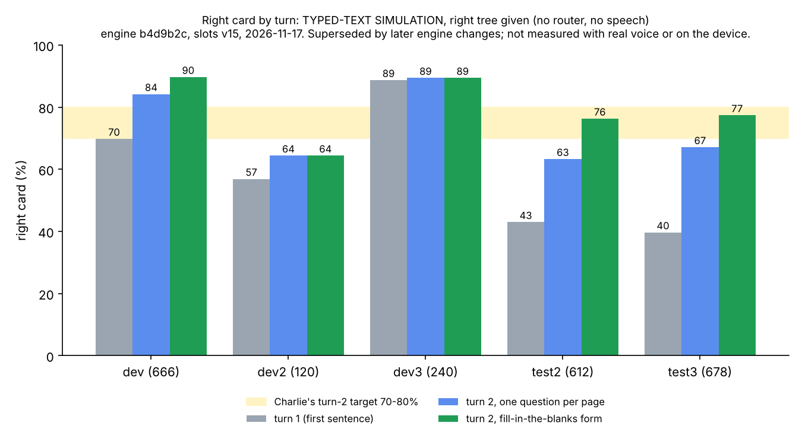
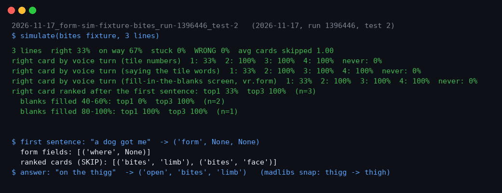

# Pocket First-Aid Librarian

An offline, hand-crank e-ink wilderness first-aid reference that fits in a pocket.
It runs on a Seeed **XIAO ESP32-S3 Plus** (16 MB flash, 8 MB PSRAM) with a PDM microphone and a
2.13" e-ink screen, works with no signal, and **never writes its own advice**: every card it shows
is a verbatim passage from a first-aid manual, with its citation on screen.

You can drive it with six buttons, or hold TALK and say what happened ("my buddy fell off a rock
and his ankle's swelling"). The voice side is a stack of small, purpose-built models and rules,
all designed and trained from scratch for this one job. **No generative language model runs on
the device.** Voice only ever picks which cited card to open.

> **Not medical advice.** This is a personal prototype, not a certified medical device, and most
> content trees are still unreviewed. In an emergency, call 911 or send an SOS first. Get real
> first-aid training; don't rely on a gadget.


*The planned voice flow. It is designed and simulated on the desktop, but not yet built or tested on the device. See [Status and metrics](#status-and-metrics).*

## Contents

- [Scope](#scope)
- [Design rules](#design-rules)
- [How a spoken sentence becomes a cited card](#how-a-spoken-sentence-becomes-a-cited-card)
  1. [The keyword-spotting voice model](#1-the-keyword-spotting-voice-model)
  2. [The router: a small mixture of experts](#2-the-router-a-small-mixture-of-experts)
  3. [Slot filling: the fill-in-the-blanks intake](#3-slot-filling-the-fill-in-the-blanks-intake)
  4. [How filled slots point to cards](#4-how-filled-slots-point-to-cards)
- [The desktop pipeline: manuals to trees to cartridge](#the-desktop-pipeline-manuals-to-trees-to-cartridge)
- [Buttons-only mode](#buttons-only-mode)
- [Status and metrics](#status-and-metrics)
- [Hardware](#hardware) · [Repository layout](#repository-layout) · [License](#license)

## Scope

**In scope (v1):**

- Civilian **wilderness first aid** with no cell signal: bleeding and wounds, CPR and choking,
  fractures, sprains and dislocations, head and spine, burns, bites and stings, hypothermia and
  frostbite, heat and dehydration, allergy, asthma, diabetic emergencies, seizures, chest pain,
  altitude, drowning, lightning, eye injuries, and improvising gear when you don't have the kit.
- Content from two primary manuals, **Aerie Backcountry Medicine *Wilderness Medicine* (15th ed.)**
  and the **American Red Cross *Wilderness and Remote First Aid*** (2010), plus older US Government
  works (ATP 4-02.11, FEMA CERT, NWS, Ready.gov and others) for the public library.
- Buttons-only use, and voice on top of it.
- Rescue extras on the hardware: flashlight and IR SOS strobe, CPR pace light, LoRa SOS.

**Out of scope:**

- Any generative model on the device, or any device-written advice. Desktop-only helpers
  (Claude, local Ollama models) may help write *training sentences* and *test sets*; they never
  write card text.
- Open-ended speech transcription or chat. The recognizer only needs the words that fill blanks.
- Diagnosis. The device opens the manual's own card for the situation described; it doesn't
  decide anything the manual doesn't say.
- Military/tactical medicine as a focus, and survival topics for now (survival comes later).
- Sale or distribution. This is a personal prototype. The two primary manuals are copyrighted and
  used from personal copies only: **their text, citations, trees built from them, slot files and
  recordings of anyone's voice are never committed to this repository.** Only code, public-domain
  content, test fixtures, and metrics are.

## Design rules

1. **Tiny hardware on purpose.** Keep the intelligence narrow and make it fit an ESP32-S3, with
   clever on-chip tricks instead of co-processors.
2. **Buttons first.** Everything works perfectly with buttons alone. Voice is an extra layer.
3. **No generative AI on the device.** Fully offline. Every model output is an index: a word id,
   a topic id, a card id.
4. **Never invents text.** Only verbatim, cited passages. Life-threat cards are always reachable
   and never hidden.
5. **Built from scratch where possible.** The recognizer, router, slot filler, cartridge format
   and reader are all our own code.

## How a spoken sentence becomes a cited card

> **Status:** this section describes the planned design. The router and the recognizer exist and
> have been scored on their own. The slot-filling form exists only as a Python engine on the
> desktop. The whole chain has not been tested end to end or run on the device yet
> ([details](#what-has-and-hasnt-been-tested-as-of-2026-11-18)).

```
 hold TALK ──► 1. recognizer ──► 2. router (MoE gate) ──► life rules ──► 3. slot filling ──► form ──► cited card
 "fell, ankle,   keyword spotting   keeps top 2-3 trees      not breathing,    fills every likely    only the      or SKIP:
  swelling"      core list, then     loads their vocab +      heavy bleeding    tree's blanks at      missing       likely cards,
                 sector re-decode    templates                → card NOW        once                  blanks        best first
```

### 1. The keyword-spotting voice model

*Code: `pipeline/speech/fasr` (PR #17). Desktop training, on-device inference.*

The recognizer is a small acoustic model trained from scratch. It is a **keyword spotter**, not a
transcriber: its only job is to catch the words that fill blanks (body parts, animals, "spurting",
"can't walk", "not breathing", numbers, "skip"...). Word error rate on full sentences isn't the
target; keyword recall, wrong keywords per sentence and missed life-threat words are.

- **Model:** a causal 1-D convolutional network (depthwise + pointwise blocks, no recurrence, no
  attention) trained with **CTC** over 39 ARPAbet phonemes plus a word-boundary and a blank token.
  The default size is about 0.53 M weights (about 0.55 MB as int8), roughly 25 M multiply-adds per
  second of audio. It streams, because every layer only looks backwards.
- **Lexicon-constrained decoding:** a beam search walks a phoneme trie built from a shared
  lexicon (`pipeline/plb/content/lexicon.yaml`, global uint16 ids, append-only, ids 0-9 reserved
  for unknown, numbers and commands). It can only spell words in the lexicon, so a new word needs a
  lexicon line, not retraining.
- **Garbage (filler) model:** off-list speech ("so we were hiking and...") is absorbed by a
  garbage word that outputs `<unk>` (id 0). Entering it and each phone inside it carry a penalty,
  which keeps real keywords from being swallowed while stopping chatter from turning into false
  keywords. A fitted reject score (8 signals) catches noise and non-speech.
- **Two-pass decode with genre vocabularies:**
  1. **Pass 1** decodes with a small *core* list: router words, life-threat words, numbers and
     commands.
  2. The router picks the likely **sectors** (genres such as bones and joints, bites and stings,
     cold, heat, breathing and CPR; see [`sectors.yaml`](pipeline/plb/content/voice/sectors.yaml)).
  3. **Pass 2** re-searches the *same* acoustic scores (no second pass through the network) with
     the union of those sectors' word lists. Smaller, relevant vocabularies mean fewer confusions.
     Life-threat words live in every sector so they are never dropped.
- **Biasing:** life-threat words get a decoder bonus, and a confident life word vetoes a reject.
  Form fields can bias toward the words their blank expects without forbidding anything else.
- **Output** is the router's `voice_hyp_t`: up to 5 best guesses, each up to 16 word ids with a
  0-100 confidence, plus a 0-100 reject score.
- **Training data:** LibriSpeech for general English sounds, then TTS voices speaking first-aid
  sentences, then recordings made through the device's own mic with a small recorder firmware.
  Wind, water, breath and echo noise are mixed in. Held-out sentences and a held-out speaker are
  never trained on. A Whisper + LoRA model on the desktop acts as a teacher to label unscripted
  clips; it never runs on the device.
- **On the device:** two engines for the same int8 model, a hand-written C path (own FFT/mel and
  int8 layers) and ESP-DL, behind a Kconfig switch, to compare speed, size and agreement.
  ESP-SR MultiNet stays as a fallback until the custom model wins on the bench.

### 2. The router: a small mixture of experts

*Code: `pipeline/voice_router/vr` (training), `firmware/components/vrouter` (C inference).*
*Design doc: [`docs/VOICE_ROUTER.md`](docs/VOICE_ROUTER.md).*

The router works like the **gating network of a mixture of experts (MoE)**. Each diagnostic tree
(fractures, bites, hypothermia...) is an *expert* with its own vocabulary and its own blank
template. The router reads the recognizer's word ids and scores every tree, then keeps the
**top 2-3** (top-k gating). Only those experts take part in the rest of the turn.

- **Model:** each word id maps to an embedding row, weighted by recognizer confidence and by which
  guess it came from. Hashed word pairs and "word after a negation" rows let "can't move" and
  "isn't broken" mean what they say. The rows are averaged into one small ReLU layer and a softmax
  over topics, plus a "reject / say that again" class. Training-only tricks (character trigrams
  folded into word rows, a MiniLM teacher for the starting rows, distillation) cost the device
  nothing.
- **Deployment:** int8 weights in a `VXP1` blob, read in place from memory-mapped flash. The
  router (about 88 KB) is always mapped. When it picks the top trees, their **sector vocabularies
  and slot templates** are the only ones brought into the working set for pass 2 and slot filling.
  That is the "MoE into RAM" idea: many experts on flash, only the 2-3 relevant ones active.
  Host test parity between the Python and C versions is within 1e-7.
- **Safety:** life-threat words are pinned so they always reach the life rules, the router only
  auto-opens a topic at 97% confidence or more (otherwise it offers tiles), and anything off-topic
  rejects instead of guessing.

### 3. Slot filling: the fill-in-the-blanks intake

*Code: `pipeline/voice_router/vr/intake.py`, `vr/form.py`. Plain-English overview:
[`docs/VOICE_INTAKE.md`](docs/VOICE_INTAKE.md).*

The technical name for this is **slot filling**, also called **frame-based** or **form-filling
dialogue**. Each tree is a *frame* (a template) with *slots* (blanks): body part, cause, animal,
bleeding type, can walk, still bleeding, getting worse, and so on. Blanks shared across trees
(awake, breathing, bleeding, where, how long ago, age) are filled once for every tree.

1. **The first sentence fills as many slots as it can**, in every candidate tree at once. Each slot
   lists the words and phrases that fill each value. A slot is only ever filled by a word the
   person actually said, **never guessed**. Negated or hedged words fill nothing ("not
   spurting", "can't tell if she's breathing"). When two values match, ties go to the most severe.
2. **Life threats first.** Every candidate tree has life rules (not breathing, unresponsive,
   spurting blood, bone through the skin...). If one fires, its card opens straight away on the
   first sentence with the general "do this now" text.
3. **Screen 2 is one form** that lists every blank still open on the way to a card, the **most
   telling** one first (the blank that splits the remaining cards most evenly). Follow-up blanks
   appear as answers land ("which bone" once "arm" is known). If the trees still compete, a
   "Which is it?" field sits on top. One spoken answer can fill several blanks at once.
4. **Each blank has its own short answer list** and a field decodes against that list. A near-miss
   word **snaps** to the closest answer by fuzzy string match ("ankel" to ankle, "thigg" to thigh),
   but only when one answer is clearly closest (score at least 0.80 and 0.10 ahead of the next).
   **Life-threat slots never snap**: there a near miss asks again instead.
5. **Ranked cards even with partial answers.** Every card the filled slots still allow is ranked,
   emergency cards first and then by partial evidence, so the right card is usually in the **top 3
   even with only about 60% of its blanks filled**.
6. **Skip** with UP+DOWN together, or say "skip" or "I don't know": the device lists those ranked
   cards to pick with the buttons.
7. **Tabs:** hold **TALK** for one problem. Hold **TALK + WIN_R** for a complex case or several
   injuries: each problem the sentence names opens in its own tab (up to 5 windows, WIN L/R to
   switch), each with its own form.



*Mockups (drawn 2026-11-17), not screenshots: these screens don't exist in firmware yet. Drawn
at the panel's real 250x122 (shown 2x). Wording is illustrative, not manual text.*

### 4. How filled slots point to cards

The trees stay the single source of truth. Slot filling never adds a path the tree doesn't have;
it only **walks the tree for you**.

- Each **question card** in a tree carries `slot:` (the blank it asks), and each of its answers
  carries `value:` (what that answer means). For example, a "Where is the bite?" card has
  `slot: where`, with answers `value: limb` and `value: face` leading to different cards.
- A per-tree **slot map** adds the words that fill each value, the **life rules** (`if:
  {breathing: "no"}` then go to the CPR card, checked in order, first match wins, optional
  `unless:`) and `implies:` links (forearm implies arm, so a fine answer satisfies a coarser card).
- `walk()` starts at the tree's root. At each question card it looks up the filled value for that
  card's slot and follows the matching answer. At a plain card it only moves on if exactly one way
  forward leads to an answered blank. It stops at the first card whose blank is still empty (that
  becomes a form field) or at a final answer card (which opens).
- So the blanks are just a faster way to press the same buttons: **voice and buttons always end on
  the same signed-off, cited card.**
- The desktop builder checks the wiring at bake time (`plb slots`): every answer value is unique
  on its card, every answer and life rule points at a card that exists, every life rule names a
  slot and value some card actually uses, and the router's slot files agree with the trees.

## The desktop pipeline: manuals to trees to cartridge

*Code: `pipeline/plb` (builder), `romkit/` (cartridge format and C reader), `pipeline/gpu/bake.sh`.*

```
 manual PDFs ──► extract ──► diagnostic trees ──► checks ──► pack ──► library.bin ──► flash
 (sha256-pinned)  numbered     question cards       verbatim,   Re-Pair +   read in place
                  paragraphs,  with slots, answer   slots,      Huffman     by the C reader
                  figures      cards with cites     schema      text
```

1. **Extract.** Each manual PDF is pinned by sha256. The builder pulls numbered paragraphs,
   headings and figures into an intermediate form.
2. **Build diagnostic trees.** Each topic becomes a YAML tree: question cards (with `slot:` and
   `value:` for voice) leading to answer cards. An answer card holds **only verbatim passages**
   with their page or paragraph citation. Where the manuals disagree, the choice goes to Charlie
   one item at a time. Every "use your kit" branch has an "I don't have this" path to the
   improvised-gear tree.
3. **Bake.** `bake.sh` runs every check and fails on real problems: schema validation, `plb
   verbatim --cards` (each card's words must appear on the cited PDF pages), `plb slots` (the
   wiring checks above), packing, a readback of every card through the C reader, and the voice
   intake simulation for each tree.
4. **Pack.** `romkit` packs a Game Boy-style cartridge, `library.bin`: dictionary-coded text
   (Re-Pair + canonical Huffman), 1-bit pictures (context model + range coder), the tree table,
   and the region/season tags. The firmware reads it in place from flash with no filesystem.
   Format spec: [`romkit/FORMAT.md`](romkit/FORMAT.md).
5. **Two libraries.** The *public* library uses only US Government works and lives in this repo.
   The *personal* library adds the Aerie and Red Cross trees, is built only on the desktop from
   personal copies, and is flashed to Charlie's own device. It is never committed.

## Buttons-only mode

Buttons are unchanged by the voice rebuild. The start screen has two tiles, **Injury** and
**Survival**, leading to folder tiles and topic tiles. Inside a topic the tree goes page by page:
one question per screen, one button per answer, then the cited card. Answer tiles also carry
numbers 1-4, so you can say the number. Context tags (activity, season, US state) hide pages that
don't apply; emergency pages are never hidden. Waking from sleep returns to the last page.



*Button mode as rendered by the PC screen simulator from the public library (older ATP-based
bleeding tree). Not the voice form.*

## Status and metrics

**Read this first:** the new voice flow (sector re-decode, router keeping 2-3 trees, slot filling,
one form screen, tabs, SKIP) has **not been tested end to end, and none of it runs on the device
yet**. What exists is a Python engine with unit tests and one desktop simulation on typed
sentences. Every number below says which setup and which date it measured. None of them are
real voices going through the whole new flow.

### What has and hasn't been tested (as of 2026-11-18)

| Piece of the new flow | Tested? | How |
|---|---|---|
| Recognizer, single pass, no sectors | Partly | Desktop, Charlie's held-out recordings (2026-11-17). Not on the board |
| Recognizer two-pass sector re-decode | **No** | Code exists; per-question word lists tried, full sector re-decode not scored |
| Router picking a topic | Partly | Desktop, typed test sentences (2026-11-16), **old flow**: one topic, then the tree page by page |
| Router keeping top 2-3 trees for the form | **No** | Not scored; the form sim below assumes the right tree |
| Slot filling + one-form screen | Simulated only | Python sim on typed sentences, right tree given, perfect answers (2026-11-17) |
| Fuzzy snap, SKIP, ranked top-3, tabs | Unit tests only | `pipeline/voice_router/tests` (47 pass, 2026-11-17) and a 3-line fixture sim |
| Form screen, tabs, SKIP in firmware | **No** | C port not started |
| Whole chain: audio to recognizer to router to form to card | **No** | Needs the C port and the recognizer bench |
| On-board speed and memory | **No** | Not measured |

| Piece (not voice) | State |
|---|---|
| Cartridge format, C reader, public library | Working on the bench |
| Personal trees (Aerie + Red Cross), 24+ topics | Built and baked on the desktop, verbatim, **unreviewed** |
| Buttons-only mode | Working on the bench with the public library |

### Slot-filling simulation (new flow, engine only, 2026-11-17)

Setup: `vr.intake --sim` at engine commit b4d9b2c, slot files v15, run on the desktop on
2026-11-17. Input is **typed** test sentences written by language models (not speech, not
Charlie's own words). The **right tree is given** (no router), and on turn 2 the simulated person
says the **correct answer for every open blank**. So this measures how well the slot engine and
the trees work together, as a best case. It does not measure the full voice flow.

| Set | Turn 1 (first sentence) | Turn 2, one question per page (old flow, same sim) | Turn 2, fill-in-the-blanks form (new flow) |
|---|---|---|---|
| dev (666 lines) | 70% | 84% | 90% |
| dev2 (120) | 57% | 64% | 64% |
| dev3 (240) | 89% | 89% | 89% |
| test2, held out (612) | 43% | 63% | 76% |
| test3, held out (678) | 40% | 67% | 77% |



*Chart: same simulation as the table (engine b4d9b2c, 2026-11-17). It is not a measurement of
the device or of speech.*

- In this best case, the held-out sets reach 76-77% by turn 2. The dev sets score higher because
  the engine was tuned on them. The goal is 70-80% by turn 2 and 100% by turn 3 in real use.
  This simulation can't show whether that goal is met yet.
- Turn 1 is low partly by design, because many test lines don't state the deciding facts.

### Earlier measurements (not the new flow)

- **Router, 2026-11-16, round 3, old flow** (router picks one topic, then page by page). Typed
  held-out sentences from a different model family than the training data: top-1 59%, top-6 87%.
  On Claude-written tests: 79-86% top-1. The router's top 2-3 output feeding the form has not been
  scored.
- **Recognizer, 2026-11-17, model `firstaid` (round 1), single pass, no sector re-decode.**
  Charlie's held-out recordings on the desktop: keyword recall about 70%, about 0.3 wrong keywords
  per clip, 98-100% of pure noise rejected. Giving each question its own word list raised top-1
  keyword accuracy by 6-11 points on the same clips. Round 2 (`firstaid2`) cut wrong keywords but
  did worse end to end through the router, so round 1 stays the baseline.

### Run captures

Every training run, simulation and test saves a terminal-style capture to [`docs/runs/`](docs/runs/)
(named `<date>_<what>_run-<run>_test-<n>.png`), with metrics only, never manual text. The one
below is a **3-sentence fixture** for the bites tree run through the new form engine
(2026-11-17). It shows the engine working, including a fuzzy snap. It is not an accuracy result.



**Next:** the C port of the form screen, then the first end-to-end test (recorded audio, then the
recognizer, then the router's top 2-3, then the form, then the card), scored on held-out speakers.
After that come on-board timings, more trees and synonyms, and Charlie's review of the personal
trees.

## Hardware

| Part | Choice |
|---|---|
| Brain | Seeed XIAO ESP32-S3 Plus (16 MB flash, 8 MB PSRAM); plain XIAO S3 on the bench |
| Screen | Waveshare 2.13" B/W e-ink, 250×122, edge-lit by warm-white LEDs |
| Mic | Adafruit PDM microphone, powered from a GPIO |
| Buttons | 6 sealed buttons, each on its own RTC GPIO (window left/right, up/down, TALK, BACK) |
| Rescue signals | 3 W white bead (flashlight, Morse SOS), 3 W 850 nm IR bead (SOS for night vision), CPR pace LED, Meshtastic LoRa SOS on a power-switched second board |
| Power | 300 mAh LiPo; hand crank (N20 gear motor) and USB-C through the XIAO's charger; supercap bank; temperature switch stops charging in the cold |
| Case | About 91 × 38 × 21 mm, PETG, gasketed |

Pin map: `firmware/main/board.h`. Bench wiring and flashing: [`firmware/README.md`](firmware/README.md).

## Repository layout

| Folder | Contents |
| --- | --- |
| `firmware/` | ESP-IDF 5.3 C firmware (e-ink, buttons, lights, sleep, voice), `components/vrouter`, the recorder firmware, and the PC screen simulator |
| `romkit/` | Cartridge format: packer, text and picture codecs, font packer, C reader, tests |
| `pipeline/plb/` | The manuals-to-cartridge builder: extraction, trees, verbatim and slot checks |
| `pipeline/voice_router/` | Router, experts, slot filling and form engine, simulators |
| `pipeline/speech/` | The keyword-spotting recognizer: model, decoder, training, evaluation, export |
| `pipeline/gpu/` | Desktop scripts (bake, long training runs with pause/resume) |
| `docs/` | [`VOICE_INTAKE.md`](docs/VOICE_INTAKE.md), [`VOICE_ROUTER.md`](docs/VOICE_ROUTER.md), [`DESIGN_HISTORY.md`](docs/DESIGN_HISTORY.md), figures and run captures |
| `hardware/` | Parts lists, wiring and enclosure files (coming) |

`firmware/components/cart` points at `../../../romkit/reader`, so keep `firmware/` and `romkit/`
side by side. CI runs the schema check, the pipeline tests and the reader tests on test fixtures
only, with no manual PDFs.

How every idea changed, the dead ends and the decisions are in
[`docs/DESIGN_HISTORY.md`](docs/DESIGN_HISTORY.md).

## License

- Code: [GPL-3.0](LICENSE).
- Fonts in `romkit/fonts/`: SIL Open Font License 1.1.
- Public library content: US Government works, public domain (17 USC 105), cited on every card.
- The Aerie and Red Cross manuals are copyrighted. Nothing from them is in this repository.
