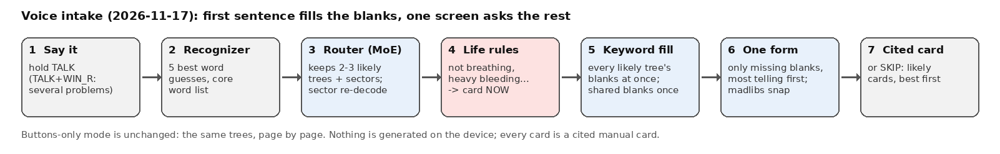
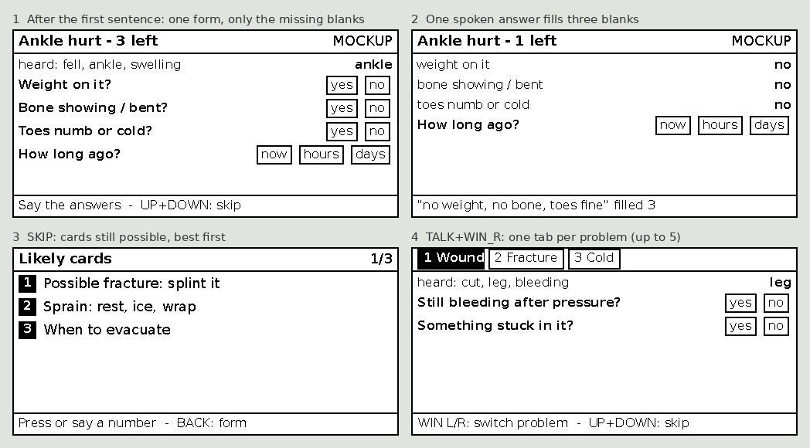

# Voice intake: the new layout (Charlie, 2026-11-17)

Buttons stay exactly as before: manual mode walks a tree page by page. Voice mode is rebuilt
around one idea: **the first sentence fills in the blanks, one screen asks for the rest, then the
cited card opens.** Nothing is generated on the device; every card shown is a signed-off,
cited manual card.

## The flow

1. **Hold TALK and say what happened.** ("my buddy fell off a rock and hurt his ankle, it's swelling")
2. **Recognizer** (speech thread) turns the audio into the 5 best guesses at the words, using a
   small *core* word list (router words, life-threat words, numbers, commands).
3. **Router** (the MoE gate) keeps the 2-3 likely topics/trees and their sector(s). The speech side
   re-decodes the same audio with those sectors' bigger word lists (`Candidate.hyps`).
4. **Emergencies first.** If any candidate tree's life rule fires (not breathing, unresponsive,
   heavy bleeding, bone through the skin, CO and not breathing...), that card opens at once with
   its general "do this now" text. Any detail it still needs shows on the open card.
5. **Keyword fill** in every candidate tree at once: each tree is a template of blanks (body part,
   cause, swelling, can walk...). Shared blanks are filled once for all trees.
6. **One fill-in-the-blanks screen** lists every blank still open on the way to a card, the most
   telling one first (the one that splits the remaining cards most evenly); follow-up blanks
   appear as answers land ("which bone" once "arm" is known). If the trees still compete, a
   "Which is it?" field sits on top. Each blank takes only its own short list of answers
   ("madlibs"); a near word snaps to the closest answer, never on a life-threat blank.
7. **The card opens.** Or press **SKIP** (UP+DOWN, or say "skip" / "I don't know"): the device
   lists the cards the answers so far still allow, best first (emergency cards first, then by
   partial evidence), to cycle through with the buttons.

**Tabs:** hold **TALK + WIN_R** for a complex case or several injuries: each problem the sentence
names opens in its own tab (up to 5 windows, window L/R switches), each with its own form.
Plain TALK is always one problem.

*Mockups at the panel's real 250x122 (drawn 2x); wording is illustrative, not manual text. The C
port of these screens is next.*

## Where things live

| Piece | File |
|---|---|
| Slot filling, walk, per-page answers, life rules | `pipeline/voice_router/vr/intake.py` |
| Fill-in-the-blanks form, tabs, snap, skip, ranking | `pipeline/voice_router/vr/form.py` |
| Sectors (genre -> trees) for per-sector vocab | `pipeline/plb/content/voice/sectors.yaml` |
| Router / experts | `pipeline/voice_router/vr/{model,train}.py`, `firmware/components/vrouter` |
| Tests | `pipeline/voice_router/tests/test_{intake,form}.py` |

Slot files (each tree's blanks and answer words) and the personal trees are built from personal
copies of the manuals and stay on the desktop, gitignored.

## Scoring

`python -m vr.intake <tree> --trees ... --slots ... --sim seeds.yaml` prints right-card-by-turn for
one question per page, saying tile words, and the fill-in-the-blanks screen, plus the right
card's top-1/top-3 rank after the first sentence alone, split by how many blanks it filled.
Tuning uses the dev sets only; test sets are scored once per change.

*Measured 2026-11-17, engine b4d9b2c, slots v15. Input is typed test sentences (no speech), the right tree is given (no router), and the simulated person says the correct answer for every open blank, so this is a best case for the slot engine alone. The full voice flow (audio, recognizer, router top 2-3, form, card) has not been tested end to end yet.*

Run captures (terminal output of each training run / simulation) live in [docs/runs](runs/).
Figures are made by `docs/voice/make_voice_figures.py` and `docs/voice/make_turn_chart.py`.

Not yet done: the C port of the form screen in firmware, and on-board timings.
