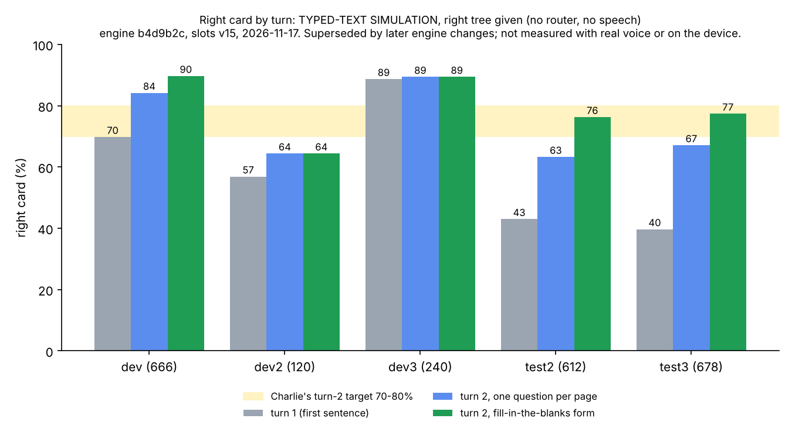

# Voice intake: the new layout (Charlie, 2026-11-17)

> **Status, 2026-11-17: designed and simulated in Python only. The full flow has not been run
> end to end, with real speech or on the device.** See [What has been tested](#what-has-been-tested).

Buttons stay exactly as before: manual mode walks a tree page by page. Voice mode is rebuilt
around one idea: **the first sentence fills in the blanks, one screen asks for the rest, then the
cited card opens.** Nothing is generated on the device; every card shown is a signed-off,
cited manual card.

## Why the intake changed

The voice intake was redesigned on 2026-11-17 because the first version's own test results
showed it could not meet the goal.

**Version 1: one page per voice prompt.** Voice walked the same tree as the buttons. The first
sentence filled whatever it could and jumped as far down the tree as those words allowed. After
that, each voice prompt answered **one page** (one question) and moved one step down. For
example: "Where is the injury?", then "Which bone?", then "Is bone showing?", one page each.

**How it was tested.** This was a PC simulation, not speech and not the device:
- The test sentences were typed lines written by language models.
- The engine was given the right tree.
- For each page it reached, the simulator "said" the right answer's words.
- The score was whether the right card was open after voice prompt 1, 2 and 3.

**Result.** On the held-out sets (test2 and test3, never tuned on), the right card was open:
- after prompt 1: 43% and 40%;
- **after prompt 2: 63% and 67%**;
- after prompt 3: 86% and 88%.

Charlie's goal is 70-80% after the second prompt.

**Why prompt 2 fell short.** Many cards sit two or three questions below where the first
sentence lands. With one question per prompt, prompt 2 can only move one step, so a card that
still needed two answers could never open by prompt 2, however well the words were heard. The
shortfall came from the layout, not from recognition.

**Version 2: the fill-in-the-blanks form (this document).** After the first sentence, one
screen lists **every** blank still open, and one spoken answer can fill several at once. The same
simulation on the same sentences reached **76% and 77% after prompt 2**. Emergencies (not
breathing, unresponsive, heavy bleeding...) still open their card on the first sentence. Button
(manual) mode keeps the page-by-page tree. In the chart below, the blue bars are version 1 and the
green bars are version 2.

Both versions were scored under the same easy conditions (typed text, right tree given), so the
gain from 63-67% to 76-77% comes from the layout change alone. Real-speech and router-in-the-loop
numbers have not been measured for either version yet. See [What has been tested](#what-has-been-tested).

## The flow

1. **Hold TALK and say what happened.** ("my buddy fell off a rock and hurt his ankle, it's swelling")
2. **Recognizer** (speech thread) turns the audio into the 5 best guesses at the words, using a
   small *core* word list (router words, life-threat words, numbers, commands).
3. **Router** (the MoE gate) keeps the 2-3 likely topics/trees and their sector(s). The speech side
   re-decodes the same audio with those sectors' bigger word lists (`Candidate.hyps`).
4. **Emergencies first.** If any candidate tree's life rule fires (not breathing, unresponsive,
   heavy bleeding, bone through the skin, CO and not breathing...), that card opens at once with
   its general "do this now" text. Any detail it still needs shows on the open card.
5. **Keyword fill** in every candidate tree at once: each tree is a template of blanks (body part,
   cause, swelling, can walk...). Shared blanks are filled once for all trees.
6. **One fill-in-the-blanks screen** lists every blank still open on the way to a card, the most
   telling one first (the one that splits the remaining cards most evenly); follow-up blanks
   appear as answers land ("which bone" once "arm" is known). If the trees still compete, a
   "Which is it?" field sits on top. Each blank takes only its own short list of answers
   ("madlibs"); a near word snaps to the closest answer, never on a life-threat blank.
7. **The card opens.** Or press **SKIP** (UP+DOWN, or say "skip" / "I don't know"): the device
   lists the cards the answers so far still allow, best first (emergency cards first, then by
   partial evidence), to cycle through with the buttons.

**Tabs:** hold **TALK + WIN_R** for a complex case or several injuries: each problem the sentence
names opens in its own tab (up to 5 windows, window L/R switches), each with its own form.
Plain TALK is always one problem.

*Mockups only, drawn with PIL at the panel's real 250x122 (2x); not taken from the device or the engine. Wording is illustrative, not manual text. The C port of these screens has not started.*

## Where things live

| Piece | File |
|---|---|
| Slot filling, walk, per-page answers, life rules | `pipeline/voice_router/vr/intake.py` |
| Fill-in-the-blanks form, tabs, snap, skip, ranking | `pipeline/voice_router/vr/form.py` |
| Sectors (genre -> trees) for per-sector vocab | `pipeline/plb/content/voice/sectors.yaml` |
| Router / experts | `pipeline/voice_router/vr/{model,train}.py`, `firmware/components/vrouter` |
| Tests | `pipeline/voice_router/tests/test_{intake,form}.py` |

Slot files (each tree's blanks and answer words) and the personal trees are built from personal
copies of the manuals and stay on the desktop, gitignored.

## Scoring

`python -m vr.intake <tree> --trees ... --slots ... --sim seeds.yaml` prints right-card-by-turn for
one question per page, saying tile words, and the fill-in-the-blanks screen, plus the right
card's top-1/top-3 rank after the first sentence alone, split by how many blanks it filled.
Tuning uses the dev sets only; test sets are scored once per change.

*What this chart is:* the form engine at b4d9b2c, slot files v15, 2026-11-17. The sentences were
**typed text written by language models** (dev sets by local models, test2/test3 held out). The
**right tree was handed to the engine**, so neither the router nor the recognizer took part. It
measures the fill-in-the-blanks logic alone, on the best case of perfect words and the right
tree, with the answer to the form also simulated (the sim says the right tile's words). The
engine has changed since b4d9b2c (about 10 commits, new trees, slots v16/v16b); a rescore is
running and this chart will be replaced. Real-voice and router-in-the-loop numbers will be lower and have not been measured yet.

## What has been tested

| Piece | Tested? | How |
|---|---|---|
| Keyword fill, life rules, one-form screen | Simulated | Typed sentences, right tree given, slots v15 (chart above) |
| Snap, skip, tabs, ranking | Unit tests only | 47 tests on small made-up trees; ranking also tried on one real tree (fractures) |
| Router picks the top 2-3 trees, then form | **Not yet** | Waiting on the topic-to-tree map |
| Recognizer audio into the form, sector re-decode | **Not yet** | Recognizer is scored separately (PR #17) |
| Charlie's real voice through the whole flow | **Not yet** | |
| New blanks (slots v16/v16b) | **Not yet** | Scoring is queued on the desktop |
| Firmware form screen, on-board timings | **Not started** | Mockups below are drawings, not the device |

Run captures (terminal output of each training run / simulation) live in [docs/runs](runs/).
Figures are made by `docs/voice/make_voice_figures.py` and `docs/voice/make_turn_chart.py`.

Not yet done: the C port of the form screen in firmware, and on-board timings.
