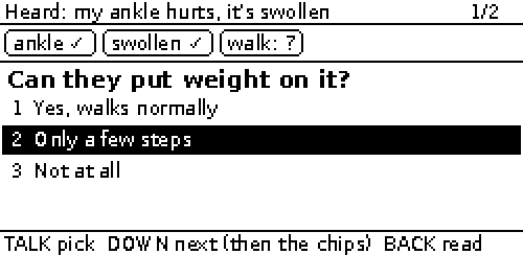
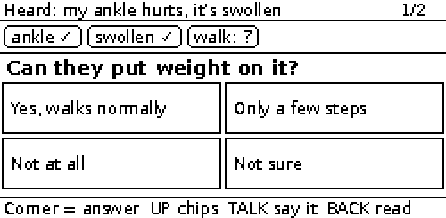

# Expert banks + filled-blanks form: design spec (Stages 1 and 2)

For sign-off before any code. Charlie's architecture: a shared acoustic trunk streams while TALK is held;
a small always-on core + life watchdog picks 1–2 injury **Expert Banks**; only those banks are pulled from
flash into RAM ("ROM bank switching"); the same Pass-1 audio is re-decoded through the expert's narrow
vocabulary to fill the blanks; the form shows what was filled and asks only what is still empty.

Stage 0 (polish) is done: d03dd59 on PR #23. On the board: 261 KB internal RAM free, largest block 196 KB,
speech task stack in internal RAM (~5 KB of 32 KB used).

---

## Stage 1: the filled-blanks form + staged cards

### Layout (250 × 122, plain board)



| Rows (px) | What |
|---|---|
| 0–11 | **Heard:** the Pass-1 sentence (cut with "…"), `1/2` = open blank 1 of 2 |
| 13–27 | **Chips:** every blank already filled (`ankle ✓`, `swollen ✓`), then the open ones (`walk: ?`). Up to ~4 chips per row; more → `+2` |
| 30–43 | The open blank's question (bold) |
| 45–107 | Its choices (3–4 rows), highlight on the cursor |
| 110–121 | Button hints |

- **Plain board (TALK, BACK, DOWN):** DOWN steps through the choices and then onto the chips row; on a chip,
  TALK **clears that blank** (it reopens with its choices). TALK on a choice picks it. Hold TALK = say the
  answer. BACK = back to reading (the form stays: Menu > Back to the questions).
- **Plus (6 buttons), ≤4 choices:** the choices become 4 corner tiles, one press per answer; UP moves to the
  chips row.



- A life rule firing, or every blank filled, opens the card straight away (as today).

### What it needs from the form engine (Diy MoE thread, parity)

1. **`filled` in every form frame:** `[{key, q, label}]` for each filled blank, so the board can draw the
   chips. A SHOW-frame format change: the form thread adds it to `vr.parity`, I port it, and parity is re-run.
2. **A "clear blank" step:** `form.unfill(key)`, so a wrong blank can be reopened. It's new behaviour, so it
   also goes Python first, then C.

### Staging candidate cards

- The cards are already in the cart (memory-mapped flash, Huffman text), so opening one costs a few ms of
  decoding. Almost all of the visible delay is the e-ink refresh (0.6–1.8 s).
- **Plan:** time card-open on the board first. Stage the top 3 `ranked_cards` (laid-out pages in PSRAM,
  ~10–20 KB each) only if decoding takes more than ~50 ms. Otherwise skip it: it would add RAM and complexity
  without a visible gain.

---

## Stage 2 (Phase A): expert banks with today's acoustic model

### Key finding that shapes the format

The global lexicon already stores every word's phones once (LEXI, 158 KB, 2,115 words). A bank therefore
doesn't need its own copy of the words. It's a list of **word ids**, and its search trie is built in RAM
when it's loaded. That makes banks tiny and keeps one source of truth for pronunciations (the i/eye kind of
fix lands once, in the shared lexicon).

### `EXPT` chunk in CRT1

```
EXPT header:  "EXP1", n_banks, core_offset, bank_index[n] = {tree_id, offset, packed_len, raw_len}
core bank:    word ids always loaded: life-threat words + topic words + commands (~200-300 ids)
bank k:       one per tree (32 today), compressed:
                word ids of the tree's own vocabulary (its slot phrases + topic words)   176-345 ids
                life-word ids (copied, so a bank alone still guards life threats)
                bias per id (domain boost; life words keep their boost)
                slot table ref = the tree's FORM record (already in the cart, by tree id)
                card refs = its NKEY range (already in the cart)
```

- **Compression:** the id lists are delta-coded and varint-packed. Sorted ids compress to ~1–1.3 bytes each.
  A bank is ~0.5–1 KB packed, and all 32 banks total **~25–35 KB**. No LZ4 is needed in Phase A. LZ4 earns
  its place in Phase B, where the neural tails are tens of KB per expert.
- **Flash math (plain 8 MB):** today's cart is 5.63 MB of a 5.94 MB partition, with **320 KB free**, so
  EXPT (~35 KB) fits easily. Nothing else moves.
- **RAM math (per loaded bank):** a trie of ~400 words (bank + core + life words) is ~2.5k nodes × 12 B,
  about **30 KB**. Two banks are ~60 KB in PSRAM. Pass-1 `logp` is already kept in RAM by streaming
  (41 tokens × up to 750 frames × 4 B, 123 KB in PSRAM).
- **Load time:** reading ~1 KB from mapped flash, unpacking and building the trie takes an estimated
  **< 2 ms** per bank, well inside the 10–25 ms budget. It will be measured.

### Flow

```
Hold TALK   ── stream: front end + acoustic model + Pass-1 search (global lexicon) ── logp kept in RAM
Let go      ── Pass-1 words (n-best) → life watchdog (universal life rules, never gated)
            ── keep_trees on Pass-1 words → top 1-2 trees  (the core gate)
Bank switch ── load bank(s) for those trees from EXPT (~2 ms), build the narrow trie
Pass-1 refill── re-run the search on the SAME logp with the narrow trie (bank words + core + life)
            ── vform fills blanks from the refill n-best (+ the Pass-1 n-best for life words)
            ── a life rule / all filled → open the card; else the filled-blanks form (Stage 1)
TALK again  ── stream as before, but the search uses the loaded bank's trie (Turn 2)
New problem ── back to the global lexicon for Pass 1
```

- **Refill cost:** today's search runs at ~0.1–0.2 s per second of audio with the full lexicon. A narrow trie
  should be faster, so the estimate is **+0.1–0.3 s after release** for a 2–3 s sentence. That's measured
  in the benchmark.

### Risk (and how it's measured)

A narrow vocabulary can **force out-of-domain speech into domain words** (a false fill). The guards are:
- the garbage `<unk>` path, kept in the narrow search;
- the calibrated reject, run on the refill too;
- Pass-1 n-best life words, which always count;
- banks never removing a life word.

### Before committing: 2A vs 2B on the PC

Both run on the same Pass-1 `logp` grid. Both are built for the benchmark only, and the winner goes to the
board.

- **2A, narrow re-decode:** the search above (`fasr_decode`), with the bank's trie.
- **2B, phrase spotting:** each open blank's choices become phoneme target sequences (from the shared
  lexicon), and each is scored straight on `logp`:
  - best-path CTC score over a sliding window, minus a garbage-model score on the same window (a free phone
    loop, for normalization);
  - accept if the normalized score clears a threshold set on the `train` split;
  - a pre-window negation check ("no", "not", "isn't", "never" within ~1 s before the hit) fills nothing,
    matching the form's negation rule.
- **Flash per expert:** 2A needs word ids only (~0.5–1 KB). 2B needs targets per choice (~2–4 KB:
  phoneme strings for each slot value), or the same ids, expanded at load.
- **Compared on the 633 recordings:** key-word recall, false triggers (fills the label doesn't support), life
  recall, and S3 time per second of audio. 2B is the likely winner for **turn-2 blanks** (2–4 choices open):
  scoring 4 targets is much cheaper and tighter than a search. 2A is likely better for Pass 1 (open
  sentence). The choice can be per turn: 2A for Pass 1, 2B for turn 2.
- **Pick rule:** fewer false triggers with equal or better life recall wins. If they tie, the faster one on the
  S3 wins.

### Measuring (PC, exactly as on the board, plus board timing)

- **Data:** the 633 labelled me_dev recordings (train / eval / answers text), plus your board clips.
- **Metrics, monolithic vs banks:** key-word recall per slot, **false fills** (a blank filled that the text
  doesn't support), life-threat word recall (must not drop), right tree in the top 2, and turn-2 answer
  accuracy on the `answers` set.
- **On the board:** bank load ms, refill ms after release, flash size, RAM high-water.
- **Pass/fail:** keep banks only if false fills drop and life recall stays equal or better.

---

## Stage 3 (Phase B), for later

- Split `fasr` into a shared trunk plus per-expert tails / LoRA. The speech thread trains them. Tails are
  int4/palette + LZ4 at ~25–40 KB each, unpacked into internal RAM and run on the trunk's saved features `H`.
- On the Plus, reclaim the 6 MB ESP-SR `model` partition in `partitions-16mb.csv` (~14 MB cartridge).
  This changes the partition table and needs one full reflash.

## What I need from you

1. Sign off the Stage 1 layout (plain + Plus) and the "clear a blank by selecting its chip" control.
2. OK for the form-thread changes: `filled` in frames, plus `unfill`.
3. Sign off the Stage 2 bank format (id lists + a trie built at load), the 2A vs 2B benchmark and the pass/fail rule.
